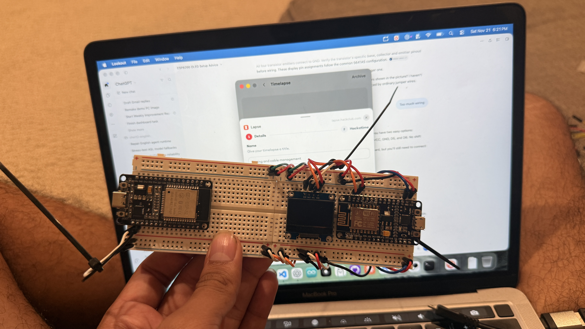
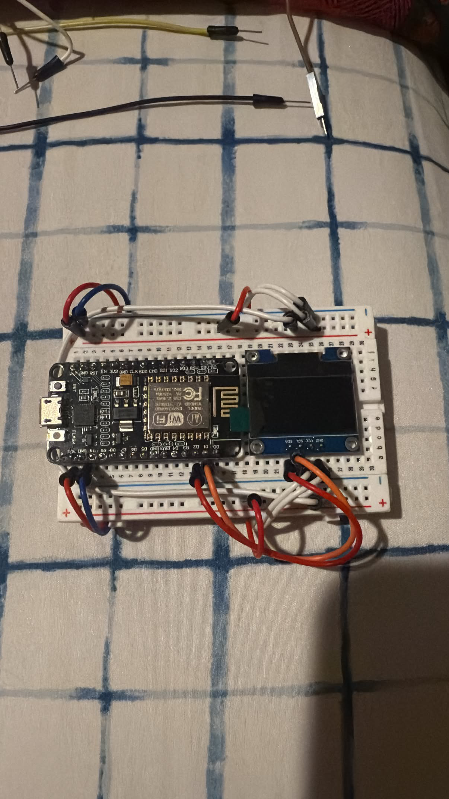
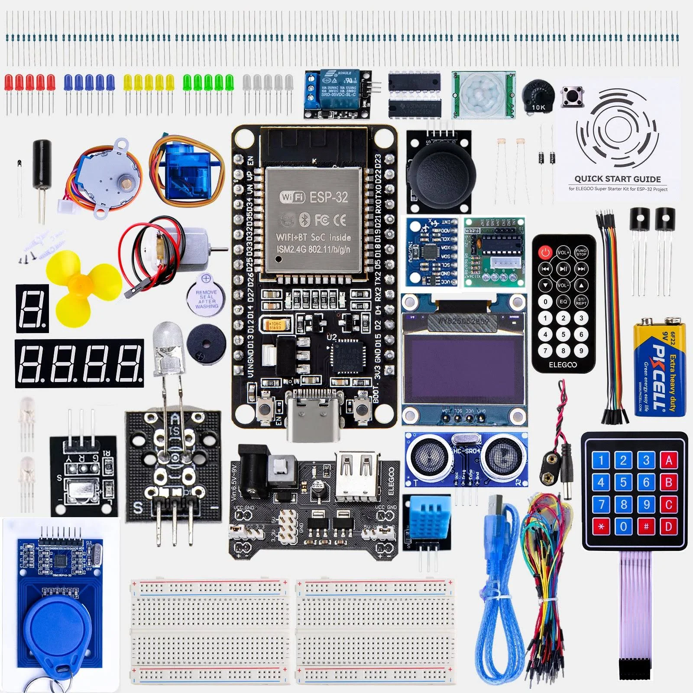

# Marki, my personal desktop part

ok so this is Marki

it is basically my little desk computer thing that i am building with ESP boards, screens, wires, and a bunch of ideas that are still becoming real lol

the main idea is to have a desktop hub that can show info, talk between boards, and give me a local place to control stuff. kinda like a tiny computer sidekick but more physical and more mine.

i wanted something that could sit next to my computer and just be there. not something i have to keep opening on my laptop or checking on my phone, but an actual little device that i can look at while doing other things.

and i wanted to make it myself.

the whole idea has changed a decent amount since i first started. at one point i was thinking of making a radio communicator using ESP boards, then i was looking at Bluetooth controls, and eventually i realized that what i actually wanted was a little desktop companion that could do a bunch of things without being unnecessarily complicated.

so now Marki is becoming a combination of those ideas.

right now it is still in the build stage. the wires are real, the boards are real, and some parts are working, but the full final version is still being figured out.

the current setup has already gone through multiple boards, different wiring layouts, a few displays, a working local Wi-Fi controller, a working buzzer test, and a very annoying LED situation that somehow ended up teaching me more about resistors than i expected.

i'm keeping all of that here because i want the repo to show how the project actually happened.

---

## what i am building

Marki is planned to have:

- two ESP boards that can communicate with each other
- local controls and a local hub style interface
- small displays for status and information
- a setup that can send information back and forth
- a desk friendly design that can keep growing over time
- a place to test hardware ideas without needing everything to be perfect first

the main thing is that i want it to be useful without needing to do too much.

i don't need it to be a whole computer. i already have a computer. i just want a small thing sitting on my desk that does a few specific things really well.

### some of the things i want Marki to do

**clock and date**

this is probably the most obvious one. i want Marki to be able to show the time and date, but i don't want that to be its only purpose. it would just be one of the modes that i can switch to whenever i want.

**tasks**

i want to be able to send a task to Marki and have it sit on the display. something like what i'm currently working on or what i need to finish next.

it sounds simple, but that's kind of the point.

**focus mode**

a little timer that i can start from my phone and leave running on the desk. eventually i want the screen, LED, and buzzer to work together with this.

**active, away, and busy**

i want Marki to have a status mode. if i'm working, it could show active. if i'm not around, away. and if i'm focusing on something, busy.

maybe the LED could change depending on the mode too.

**an idle face**

this one is mostly because i think it would be cool.

when Marki isn't really doing anything, i want the OLED to display a little animated face or something similar. nothing too elaborate, just enough to make it feel like more than a screen showing text.

**custom messages**

this is another thing i really want. type something on my phone and have it show up on Marki.

the phone would basically become the remote for the whole thing.

all of these are planned features. i haven't finished programming them yet, but they are what i'm building toward.

---

## progress so far

### 1. project idea

the first idea was a personal desktop part called Marki. something that could sit near my computer and become a control center for little tools, status info, and hardware experiments.

i started looking at the ESP boards i had and trying to figure out what i could actually build with them.

the reason i liked ESP boards was that they're small, relatively easy to experiment with, and have wireless capabilities built in. i could have one connected to a display, another handling something else, and eventually make them communicate.

at first, the project was more about figuring out what the boards could do.

now it's becoming more about what i actually want Marki to do.

### 2. first hardware testing

i started testing ESP boards with displays and jumper wires. this helped me figure out how the boards fit on the breadboard and how the screen connections could work.

the very early setup was an ESP8266 NodeMCU and a small OLED display.

this was one of the first times i was trying to get the actual hardware together.

the setup itself was pretty simple. an ESP board, an OLED, a breadboard, and a bunch of jumper wires connecting everything.

but even that involved figuring out things like:

- which pins were actually GPIO pins
- what VCC and GND meant
- how the breadboard rails worked
- what SDA and SCL were for
- how to power the board without connecting something to the wrong voltage
- how to connect the screen without taking up every available pin

the OLED uses I2C, which was nice because i didn't need a ridiculous number of wires just to connect the screen.

for the ESP8266, the initial I2C setup used D1 and D2.

when i moved to the ESP32 setup later, the planned connections changed to GPIO21 and GPIO22.

the screen is physically part of the build, but the current firmware is still the smaller LED and buzzer test. the full display interface hasn't been confirmed working yet.

### 3. the four digit display

i also wanted a four digit display.

the idea was that i could use one display for things like the time or a countdown, while the OLED handled text, tasks, and whatever else Marki was showing.

i had a 5641AS four digit seven segment display that i wanted to try.

i thought it was going to be pretty straightforward.

it wasn't.

the display itself had 12 pins, and i started looking at ways to control it without using almost every available GPIO pin on my ESP.

that's when i got into shift registers.

i found that i had two SN74HC595N chips, which could potentially help control the display using fewer GPIO connections.

that sounded great until i started looking at the actual wiring.

there were connections for all the segments, digit selection, resistors, and possibly transistors depending on how the display was being driven.

at that point i was spending more time trying to reduce the wiring than actually making the rest of Marki work.

so i decided not to make the four digit display the priority.

i might eventually use a TM1637 display module instead because it already has a driver built in and needs far fewer connections.

i still like the idea of having a separate numeric display, especially for a timer, but i want to get the main desktop companion working first.

### 4. two board setup

the next step is making two boards communicate. the goal is for one board to send information and the other board to receive it, then send useful stuff back when needed.

this part is still being tested because wiring has a way of making everything look easy until it suddenly is not easy anymore.

i started arranging the boards on a larger breadboard, with the OLED and other components between them.

this was also when i started thinking more about how the physical layout would eventually look.

i didn't want the wires to be all over the place forever, but i also didn't want to make a permanent layout before i knew which parts were actually going to stay.

the current setup has gone through a couple of different boards.

i initially used an ESP8266 NodeMCU, then experimented with ESP32 boards, and eventually used an ESP32 DevKit V1 for the current working controller test.

the boards being physically connected to the same breadboard doesn't mean they're already communicating.

that's one of the things i still need to build.

i also need to figure out the best way to power everything. for now, USB power has been the easiest way to test each controller.

### 5. screens and local controls

the displays are being used for local feedback, so Marki can show what it is doing without needing to look at a computer every second.

the local hub idea is to make controls feel close and simple. press something, see something happen, change a setting, check a status, keep going.

one thing i really wanted was to control the whole device wirelessly.

i originally looked into using a Bluetooth remote app, but the ESP8266 i was experimenting with didn't have Bluetooth.

rather than adding another component just for that, i started looking at using Wi-Fi.

this ended up being a pretty good idea because the ESP could create its own Wi-Fi network and host a little webpage.

so instead of making a whole phone app, i could just connect my phone to Marki's Wi-Fi and control things from a browser.

no internet needed.

and the webpage could eventually have buttons for all the different modes.

this became one of the first parts of the project that i actually got working.

### 6. making the first controller

i wanted to start with something simple.

not a whole dashboard with 50 different features. just a webpage that could turn an LED on and off, and eventually activate a buzzer.

the first program was written for the ESP8266.

it used the ESP8266 Wi-Fi library and web server library to create a local network and display a basic controller page.

the Wi-Fi name was Marki.

i kept the webpage very simple because i didn't see the point in making a complicated interface when i hadn't even tested whether the physical LED worked.

it was basically just a few buttons.

i could always make it nicer later.

and that was the plan until i ran into the next problem.

---

## the Arduino IDE situation

this probably took longer than it should have.

i was using Arduino IDE on my Mac to upload the code to the ESP8266.

the first issue was that Arduino didn't have the ESP8266 board package installed.

so when i tried selecting the NodeMCU, it wouldn't show up.

i had to go into Arduino IDE settings and add the ESP8266 board package URL:

\`\`\`text
https://arduino.esp8266.com/stable/package_esp8266com_index.json
\`\`\`

then install the actual package using Boards Manager.

which i also learned is different from Library Manager.

after that, i could finally select:

\`\`\`text
NodeMCU 1.0 (ESP-12E Module)
\`\`\`

and choose the USB port.

the sketch compiled successfully.

so i thought that was basically it.

but the upload kept failing.

### the upload error

the main error i kept getting was:

\`\`\`text
Failed to connect to ESP8266:
Invalid head of packet (0x00)
\`\`\`

i tried changing the upload speed, checking the USB port, unplugging and reconnecting the board, and using the FLASH and RST buttons.

the ESP8266 would briefly flash its onboard LED when it was plugged in, so i knew it was receiving power.

but that didn't mean the USB communication was working.

the annoying part was that Arduino kept compiling the program correctly.

so the code itself wasn't necessarily the issue.

the problem was getting the board to actually accept the upload.

i spent a good amount of time trying different things before deciding that i should just test the project using another ESP board.

which ended up being a pretty important decision.

---

## switching to the ESP32

i had an ESP32 DevKit V1, so i decided to try using that instead of continuing to fight with the ESP8266.

this meant changing some of the code because the ESP32 uses different libraries.

the main changes were:

| ESP8266 | ESP32 |
| --- | --- |
| ESP8266WiFi.h | WiFi.h |
| ESP8266WebServer.h | WebServer.h |
| D5 for the original LED test | GPIO18 for the new LED test |
| D6 for the planned buzzer test | GPIO19 for the buzzer test |

i also had to install the ESP32 board package in Arduino IDE and select the right board.

for this setup i used:

\`\`\`text
DOIT ESP32 DEVKIT V1
\`\`\`

after that, i uploaded the new sketch.

and it actually worked.

this screenshot is from the successful upload.

the output showed that the entire program had been written, verified, and the board was resetting.

\`\`\`text
Writing ... 100.0%
Hash of data verified.
Hard resetting via RTS pin...
\`\`\`

this was probably one of the biggest moments in the whole build so far because i could finally stop trying to upload the program and actually test what it was supposed to do.

and the ESP32 has been a much better starting point for the current version of Marki.

---

## adding the LED and buzzer

once i had the ESP32 working, i started adding some actual components that could respond to the controls.

i wanted an LED to act as a little status light and a buzzer for sounds or alerts.

the LED was connected to GPIO18.

the buzzer was connected to GPIO19 for the test.

the basic idea was that my phone could send a command to the ESP32, and the ESP32 would activate the component.

i wanted to test everything individually before combining it with the OLED and all the other features.

### the buzzer

the buzzer was one of the first components that actually responded the way i wanted it to.

i connected my phone to Marki's Wi-Fi network, opened the controller page, and used the buzzer test button.

and it worked.

that confirmed a few things at once.

the ESP32 was running the program, the local Wi-Fi network worked, the webpage could send commands, and the board was responding to those commands through the hardware.

which was pretty much exactly what i wanted to prove with the first test.

the current sketch uses a short tone for the buzzer test.

i'll eventually want sounds for things like starting a focus session, finishing a timer, or getting a new task.

but right now it's just a test.

### the LED

the LED was a different story.

i thought it would be the easier component because it's literally just a light.

the first setup didn't work, even though the Wi-Fi and buzzer were working.

so i started tracing the wiring.

the LED was on the right side of the breadboard, using the F, G, H, I, and J holes.

the connection i had made was:

\`\`\`text
ESP32 GPIO18
      |
      |
 yellow wire
      |
      v
     F1 ---- G1
             |
          resistor
             |
             G2 ---- H2 (+ LED)
                    |
                   LED
                    |
             H3 ---- I3
                     |
                     v
                 GND rail
\`\`\`

the idea was correct.

F1 and G1 are part of the same connected row.

G2 and H2 are part of the next connected row.

H3 and I3 are another connected row.

so the resistor and LED were supposed to form one path from GPIO18 to ground.

the problem was that i wasn't completely sure which resistor i had used.

and that turned into its own little adventure.

---

## learning how breadboards actually work

one of the things i had to understand properly was how electricity travels through a breadboard.

before this, it was easy to just look at all the holes and assume i knew which ones were connected.

but the actual connections are hidden underneath the plastic.

on a normal breadboard, five holes in the same numbered row on one side of the center gap are connected.

so for example:

\`\`\`text
       F   G   H   I   J

Row 1  o---o---o---o---o

Row 2  o---o---o---o---o

Row 3  o---o---o---o---o
\`\`\`

the holes in row 1 are connected to each other.

but row 1 isn't connected to row 2 unless you put a component or wire between them.

the center gap also separates the two halves of the breadboard.

the long positive and negative rails are different again.

they are useful for distributing power, but they aren't magically powered just because the breadboard has red and blue lines printed on it.

you still need to connect them to the right pins.

some breadboards also have split power rails, so i'm trying to be more careful about checking those rather than assuming the whole side is one connection.

this was particularly useful when i was troubleshooting the LED because i could actually describe each wire and resistor leg by its exact location.

and then figure out where the circuit should go next.

---

## the resistor situation

this might actually be one of the funniest parts of the project.

i had connected an LED, the ESP32 was working, the buzzer was working, and i couldn't get the LED to turn on.

i had a resistor in the circuit, but i wasn't sure what value it was.

the resistor was blue and had several tiny colored stripes.

i tried describing the colors, but some of them looked burgundy and violet and honestly i couldn't really tell what was what.

i eventually learned that the stripes are how you identify the resistance.

which is useful information that i probably should have learned before sticking random resistors into a circuit.

the ELEGOO starter kit i was using came with a bunch of different resistor values.

i went back through the kit and found a **220 ohm resistor**.

finally.

that's the resistor i decided to use with the LED.

### the corrected LED circuit

the intended connection is now:

\`\`\`text
GPIO18
   |
220 ohm resistor
   |
LED positive (+)
   |
LED negative (-)
   |
GND
\`\`\`

the resistor can be connected in either direction because a normal resistor doesn't have a positive and negative side.

the LED does have polarity, though.

the longer leg is generally the positive leg, and the shorter leg is generally negative.

i kept the circuit arranged in the same breadboard rows because the arrangement itself made sense.

the remaining thing is to confirm the LED's final ON/OFF test with the corrected resistor.

i've documented the resistor replacement, but i'm keeping that final test marked as something to verify rather than claiming it works before actually confirming it.

i don't want the README saying everything is perfect when i'm still testing things.

---

## what actually works right now

this is where Marki stands after the November 2026 build sessions.

| Component or feature | Current status |
| --- | --- |
| ESP32 DevKit V1 | Successfully uploaded and running |
| Arduino IDE ESP32 setup | Working |
| Local Marki Wi-Fi network | Working |
| Phone connection to Marki | Working |
| Web controller | Working |
| Buzzer test | Working |
| Blue LED on GPIO18 | 220 ohm resistor installed, final retest to confirm |
| OLED screen | Connected during hardware testing, display code still to finish |
| Two ESP board communication | Planned, not finished |
| Four digit display | Tested as a hardware idea, not in the current setup |
| Final desk enclosure | Not built yet |

so right now the actual working software is a small ESP32 controller that creates its own Wi-Fi network and lets me interact with some hardware through a webpage.

which is already a pretty good start.

i still want the OLED to do a lot more, and i want the boards to eventually communicate with each other.

but this is the first version where the ESP32, phone, and a real physical output have actually worked together.

---

## the current ESP32 connections

this is the working pin plan for the current test setup.

| Component | ESP32 pin | Purpose |
| --- | --- | --- |
| Blue LED | GPIO18 | LED control |
| LED resistor | 220 ohm | Limits LED current |
| Buzzer | GPIO19 | Buzzer test |
| OLED SDA | GPIO21 | I2C data |
| OLED SCL | GPIO22 | I2C clock |
| OLED power | 3V3, if supported by the module | Power |
| OLED ground | GND | Ground |

the LED and buzzer pins are used by the current ESP32 test firmware.

the OLED pin assignments are the planned I2C connections. i still need to verify the screen module and get its display code running properly.

i also need to finish checking the complete physical pin map and power connections.

if you're trying to recreate this, don't just copy the wiring from a photo and assume everything is right. check the actual GPIO labels on your board.

and don't connect an LED straight to a GPIO without a current-limiting resistor. the buzzer also needs to be appropriate for the voltage and current available from the GPIO, or driven using a separate circuit.

---

## the code

i'm keeping the firmware separate from the README because i want the repo to stay organized as it grows.

the current ESP32 test is here:

[ESP32 LED and buzzer controller](firmware/esp32_led_buzzer_test/esp32_led_buzzer_test.ino)

it uses:

- Arduino.h
- WiFi.h
- WebServer.h

the main idea is simple.

the ESP32 creates a local Wi-Fi network called Marki.

then it runs a web server on port 80.

when i open the controller page, it shows a few buttons.

those buttons send requests to the ESP32.

and the ESP32 changes the output of the selected GPIO pin.

for now the routes are:

\`\`\`text
/       controller webpage

/on     LED ON

/off    LED OFF

/beep   buzzer test
\`\`\`

i kept this code relatively simple because i wanted to know what every part was doing.

there's no point having a giant program with all kinds of effects if i don't even know which part of the hardware isn't working.

the source code in the repo uses a placeholder for the Wi-Fi password. set your own password locally before uploading it.

### uploading the current ESP32 test

1. open the sketch in Arduino IDE
2. install the ESP32 board package if needed
3. select DOIT ESP32 DEVKIT V1
4. select the USB port connected to the ESP32
5. verify the wiring and component ratings
6. set a private Wi-Fi password in the sketch
7. click Upload
8. open Serial Monitor at 115200 baud if you want to check the board's IP address

after uploading, connect your phone to Marki's Wi-Fi network.

the local page is normally at:

\`\`\`text
http://192.168.4.1
\`\`\`

the phone might say that the Wi-Fi doesn't have internet.

that's normal.

the ESP32 is hosting its own little network. it doesn't need to be connected to the internet for this test.

once the controller loads, i can use the buttons to test the components.

---

## build photos

i wanted to keep the photos as part of the README because the whole project has changed a lot since the first version.

### early wiring and board testing

this is one of the early setups. lots of jumper wires, breadboard energy, and figuring out which board is doing what.

### another hardware test

this shows the boards and display being tested together. it is not super pretty yet but it is the part where the project starts becoming an actual object.

### moving everything onto a larger breadboard

this is around the stage where i started figuring out where everything could fit.

i liked the idea of keeping the boards toward the ends and putting the screen and other components between them.

it's still pretty far from a finished device, but it gave me more room to experiment.

### adding more components

this is where the LED and buzzer started becoming part of the build.

the number of wires was definitely getting a little ridiculous, but at least i was starting to test actual functions instead of just moving the boards around.

### tracing the LED

this is from the LED troubleshooting stage.

the yellow wire was connected to GPIO18, and i was trying to figure out whether the resistor and LED were connected to the right breadboard rows.

it took a lot more time than i expected for a single LED.

### testing and planning

this is from the testing stage while working through the display and wiring setup.

the kit came with a bunch of components, which is why i kept finding new things i wanted to try adding to Marki.

some were useful immediately, and some are probably going to stay ideas until i get the main version finished.

---

## Lapse videos

these are the build videos so you can see the project happening over time.

i wanted to keep these because photos only show how everything looked at one specific moment. the timelapses actually show the process of building things, changing code, trying different setups, and figuring out what went wrong.

### original build recordings

- [Marki build timelapse 1](https://lapse.hackclub.com/timelapse/WIssxWz5a36c)
- [Marki build timelapse 2](https://lapse.hackclub.com/timelapse/qQNyRvMfsnoB)
- [Marki build timelapse 3](https://lapse.hackclub.com/timelapse/rJlyFMNfZVh0)

### more coding and development sessions

- [Marki development session 4](https://lapse.hackclub.com/timelapse/hvsxg6gp-3WR)
- [Marki development session 5](https://lapse.hackclub.com/timelapse/IgunjRW6FQJi)
- [Marki development session 6](https://lapse.hackclub.com/timelapse/crfJcFE4N9NL)

i think it'll be fun to look back at these once the project actually has a proper enclosure and everything is working together.

especially knowing how many times i had to change one little wire to figure something out.

---

## things i learned while building Marki

one of the main reasons i started this was because i wanted to actually build something and understand how it worked.

not just upload some code and say i made a project.

so a decent amount of the progress has really been me learning how the hardware works.

### breadboards aren't as confusing once you understand the connections

the biggest thing was figuring out how rows and power rails connect underneath the board.

that made troubleshooting much easier because i could actually trace the circuit instead of guessing.

### resistors matter

i learned that the resistor isn't just some optional thing that you put next to an LED.

the resistance affects how much current can flow through the circuit.

using the wrong resistor can mean the LED doesn't turn on properly, and using no current limiting can damage the LED or controller.

### LEDs have polarity

the resistor can go either way.

the LED can't.

this is probably one of the first things i should have checked properly.

### Arduino board selection matters

i went through the whole process of installing the ESP8266 board package, selecting the NodeMCU, and dealing with USB ports.

then i had to switch to an ESP32 board and use different libraries.

so now i understand a little better why the Arduino IDE needs to know exactly which board it's programming.

### compiling and uploading are different

this one took a while to figure out.

the ESP8266 program compiled successfully multiple times, but the actual upload failed.

the problem wasn't necessarily the C++ code. the computer and board weren't communicating properly during programming.

moving to the ESP32 helped me get past that stage.

### getting one thing working is better than trying to build everything at once

i originally wanted clocks, timers, status modes, animated screens, wireless communication, and all kinds of other features.

but i realized that just getting the Wi-Fi controller and buzzer working was already a useful step.

the project becomes easier to understand when i test one component at a time.

and i can always build on that.

---

## how it all comes together

the project is basically moving through a few layers:

1. hardware first, with the ESP boards, displays, breadboards, and power
2. communication next, so the two boards can actually share information
3. local controls after that, so Marki can do something useful from the desk
4. cleaner structure and enclosure ideas once the tests stop changing every five minutes
5. a final desktop version that feels like one project instead of a pile of parts

the local phone controller is already the start of that third part.

eventually i want the setup to work something like this:

\`\`\`text
              MY PHONE
                 |
                 |
              Local Wi-Fi
                 |
                 v
               MARKI
              ESP32
                 |
       +---------+---------+
       |         |         |
      OLED      LED      BUZZER
       |
       |
    Tasks
    Clock
    Focus
    Status
    Messages
    Idle Face

         +
         |
     SECOND ESP
   (future communication)
\`\`\`

this is more of a plan for how i want the project to work than a diagram of everything that is already running.

the idea is that the different components actually have a purpose.

the screen shouldn't just be there because i happened to have an OLED.

the LED shouldn't just blink for no reason.

and the buzzer shouldn't just make random sounds.

eventually i want all of them to respond to what Marki is doing.

the end goal is not just a random circuit. i want it to feel like a real personal device that has a reason to be on my desk.

---

## what still needs work

there's still a decent amount left to do.

### hardware

- confirm the final LED test with the 220 ohm resistor
- finish checking every connection on the breadboard
- verify the OLED module and get it displaying information
- decide how the second ESP board should communicate with the main one
- reduce the number of jumper wires
- figure out a better power arrangement
- make the whole thing a little more compact

### software

- create the actual Marki desktop interface
- add a clock and date mode
- add a task display
- add a focus timer
- add active, away, and busy statuses
- make an animated idle face
- send custom messages from my phone
- start working on communication between the boards
- make the local webpage nicer once the core functions work

### physical design

the current breadboard setup is proof of the idea, but it is not the final look yet.

the next versions should have cleaner wiring, better mounting, and a more finished desktop shape.

i'd eventually like to have the displays facing outward, with the boards and wiring tucked away behind them.

something that looks like it's actually supposed to sit on a desk.

i haven't decided exactly what the enclosure will look like yet.

but that's something i want to spend time on once the hardware stops changing every few minutes.

---

## project files

i'm trying to keep the actual project organized instead of throwing every single file into the main folder.

the repo currently has separate folders for the build photos, Arduino screenshots, diagrams, documentation, and firmware.

\`\`\`text
Marki
|
|-- README.md
|
|-- assets
|   |-- README.md
|   |-- images
|   |-- build-photos
|   |-- arduino-screenshots
|   |-- diagrams
|
|-- docs
|   |-- README.md
|   |-- circuit-wiring.md
|   |-- pin-map.csv
|   |-- parts-and-next-steps.md
|   |-- build-report
|
|-- firmware
    |-- README.md
    |-- esp32_led_buzzer_test
        |-- esp32_led_buzzer_test.ino
\`\`\`

### project assets and circuit wiring

the full image collection is on the [Marki assets page](assets/README.md).

the current circuit notes, component locations, and pin-map worksheet are in [circuit wiring and component placement](docs/circuit-wiring.md).

the [pin map](docs/pin-map.csv) is where i'm keeping track of the connections that still need to be checked.

the [parts and next steps](docs/parts-and-next-steps.md) page is for hardware ideas and things that still need to be figured out.

the uploaded ESP32 LED and buzzer test, plus safe upload notes, live in [firmware](firmware/README.md).

### full project report

i also put together a longer report documenting the build process.

it covers the early ESP8266 setup, the wiring experiments, the Arduino IDE issues, the ESP32 switch, the working Wi-Fi and buzzer tests, and the LED troubleshooting.

it's basically a much more detailed record of what happened while making this.

- [read the complete Marki build report (PDF)](docs/build-report/MARKI_Complete_Build_Report.pdf)
- [editable Word version](docs/build-report/MARKI_Complete_Build_Report.docx)

the README is where i want to keep the main story.

the report is there for all the smaller details, screenshots, and hardware notes that would make this page ridiculously long if i included every single one.

---

## project status

**status: active build**

this is not finished yet, but it is moving. the point of this repo is to show the whole process, including the messy parts, the tests that work, and the stuff that still needs fixing.

i've already gone through a couple of board layouts, more jumper wires than i expected, problems with uploading code, and a pretty long process of trying to get a single LED working.

but the ESP32 is finally running the controller, the local Wi-Fi works, and the buzzer responds.

and there's still a lot i want to add.

i think the coolest part will be when the screen starts showing actual useful things and the different components begin working together.

right now it's still a breadboard full of experiments.

eventually i want it to be one little desktop companion.

more updates coming as Marki gets less breadboard and more desktop.
