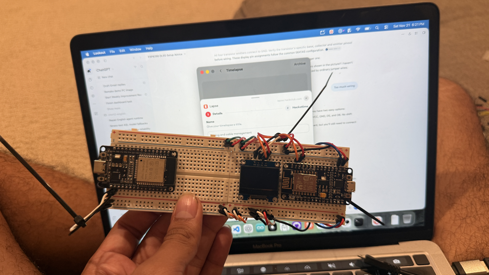
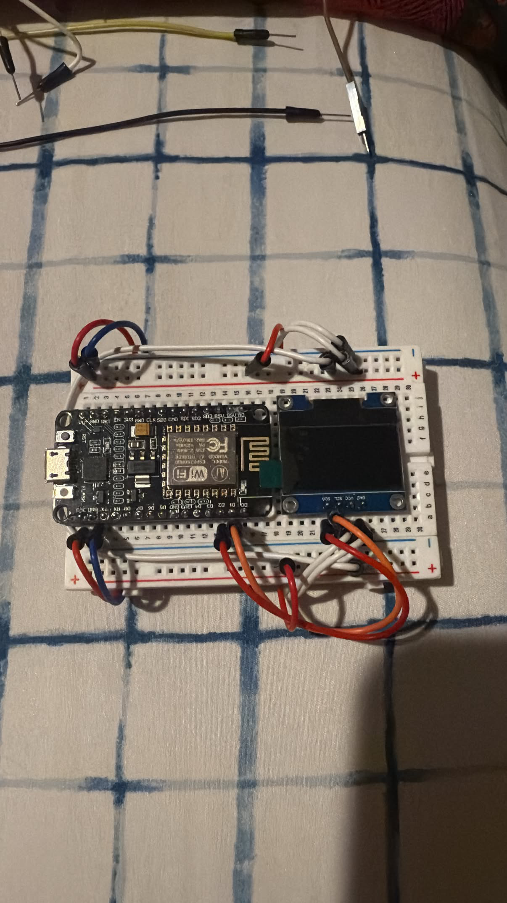
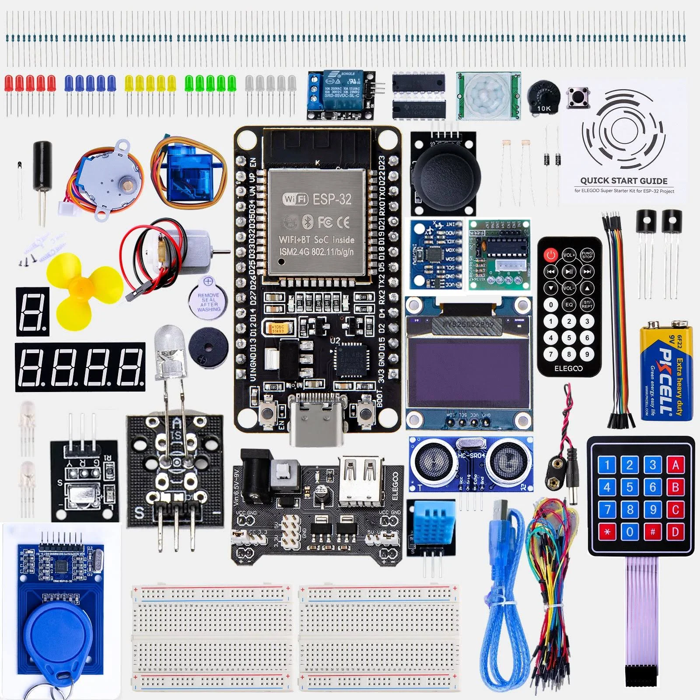

# Marki project assets

This page keeps the visual references for Marki together. The photos document the current build stage; they are not a final schematic or a confirmed pin map.

## build photos

### workbench wiring

Early workbench testing with breadboards, jumper wires, and multiple ESP development boards.

### board and OLED test

A closer view of the controller board, breadboard wiring, and small OLED display being tested together.

### ELEGOO starter-kit reference

Reference image for the larger component kit and the kinds of parts available for future Marki experiments.

## related documentation

- [Circuit wiring and component placement](../docs/circuit-wiring.md)
- [Parts and next steps](../docs/parts-and-next-steps.md)
- [Pin-map worksheet](../docs/pin-map.csv)
